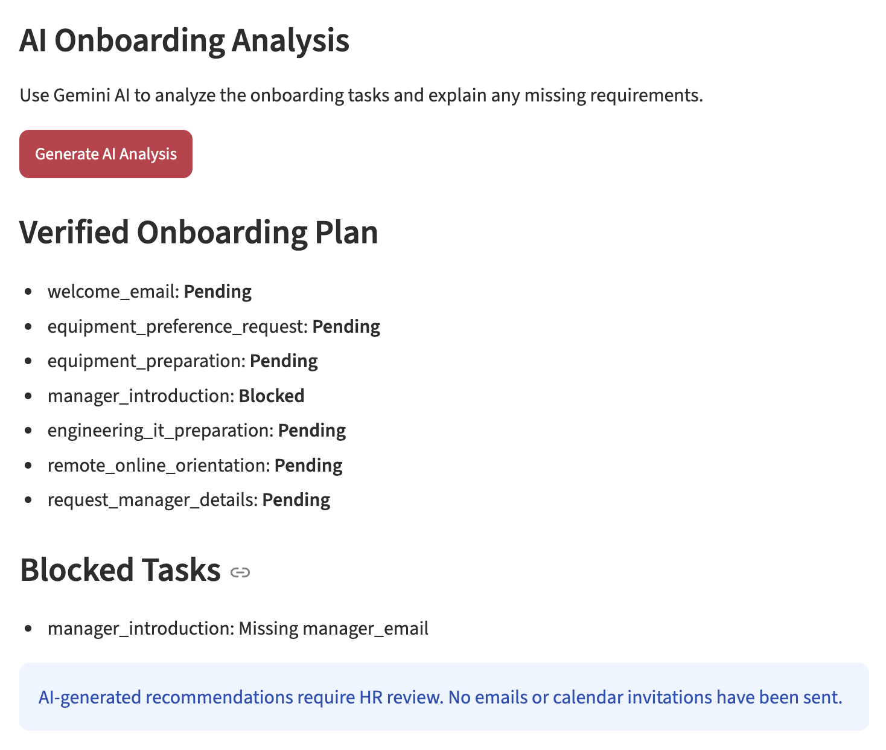
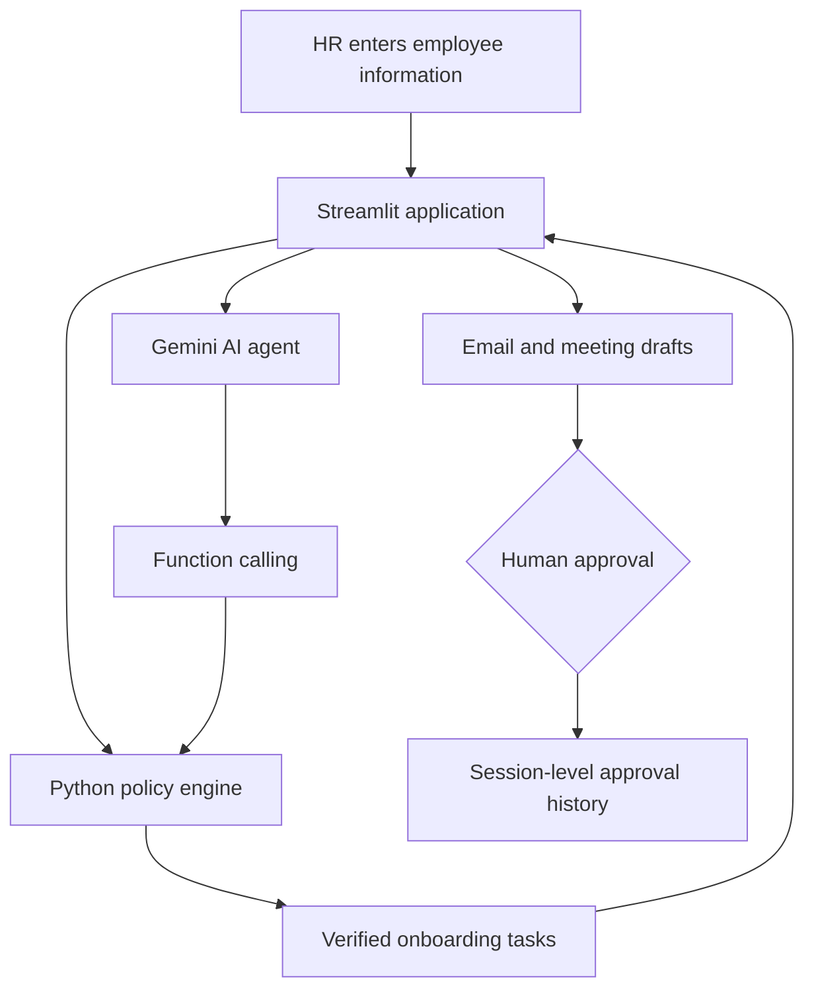

# AutoFirstHi — AI-Assisted Employee Onboarding

AutoFirstHi is a Python application that helps HR teams prepare employee onboarding plans using AI, structured company policies, and human approval workflows.

The project demonstrates how generative AI can be integrated with deterministic business rules to produce more reliable, auditable results.

**Status:** Functional portfolio prototype using fictional employee data.

**Live Demo:** [Try AutoFirstHi](https://autofirsthi.streamlit.app/)

**Source Code:** [GitHub Repository](https://github.com/Somarel/autofirsthi)

## Application Screenshots

### Employee Registration

### Policy-Verified AI Onboarding Plan

## Key Features

- **Policy-based planning:** Selects onboarding tasks from a configurable JSON policy.
- **Conditional task management:** Marks tasks as Pending or Blocked based on available employee information.
- **AI tool calling:** Uses Google Gemini to interact with Python tools for policy retrieval and onboarding planning.
- **Verified outputs:** Recalculates task statuses using deterministic Python logic rather than trusting AI-generated statuses.
- **Email preparation:** Creates personalized welcome email drafts.
- **Meeting preparation:** Drafts manager introduction meetings and validates dates against the first two working days.
- **Human approval:** Supports approving or rejecting proposed emails and meetings.
- **Audit history:** Records approval decisions during the active Streamlit session.
- **Automated testing:** Includes 11 pytest tests covering business rules and error handling.

## Technology Stack

- Python
- Streamlit
- Google Gemini API and Google GenAI SDK
- JSON-based policy configuration
- pytest
- uv
- Git and GitHub

## How It Works

1. HR enters employee information in the Streamlit interface.
2. Python selects applicable company policies.
3. The application generates tasks and checks for missing information.
4. Gemini can call Python tools to retrieve policies and generate onboarding information.
5. Python verifies the final task statuses.
6. HR can prepare, review, approve, or reject email and meeting drafts.

## System Architecture

## Project Structure

- `streamlit_app.py` — User interface, forms, approvals, and session state
- `agent.py` — Gemini integration and function calling
- `tools.py` — Policy selection, task preparation, email and meeting tools
- `policies/general.json` — DemoTech onboarding policies
- `test_tools.py` — Automated tests

## Run Locally

Clone the repository:

    git clone https://github.com/Somarel/autofirsthi.git
    cd autofirsthi

Install dependencies:

    uv sync

Configure the `GEMINI_API_KEY` environment variable securely. Do not commit API keys to Git.

Start the application:

    uv run streamlit run streamlit_app.py

Run automated tests:

    uv run pytest -q test_tools.py

## Safety and Limitations

This project is a demonstration, not a production HR system.

- All employee examples are fictional.
- Emails and calendar invitations are drafted but never sent.
- Human approval is required before any proposed external action.
- Approval history is stored in Streamlit session state, not a persistent database.
- Working-day validation excludes weekends but does not yet account for public holidays.
- Production authentication and authorization are not implemented.

## Future Improvements

- Persistent database for onboarding records and approval history
- Authentication and role-based permissions
- Swedish public holiday support
- Additional integration tests and CI
- Optional email and calendar integrations with explicit authorization
