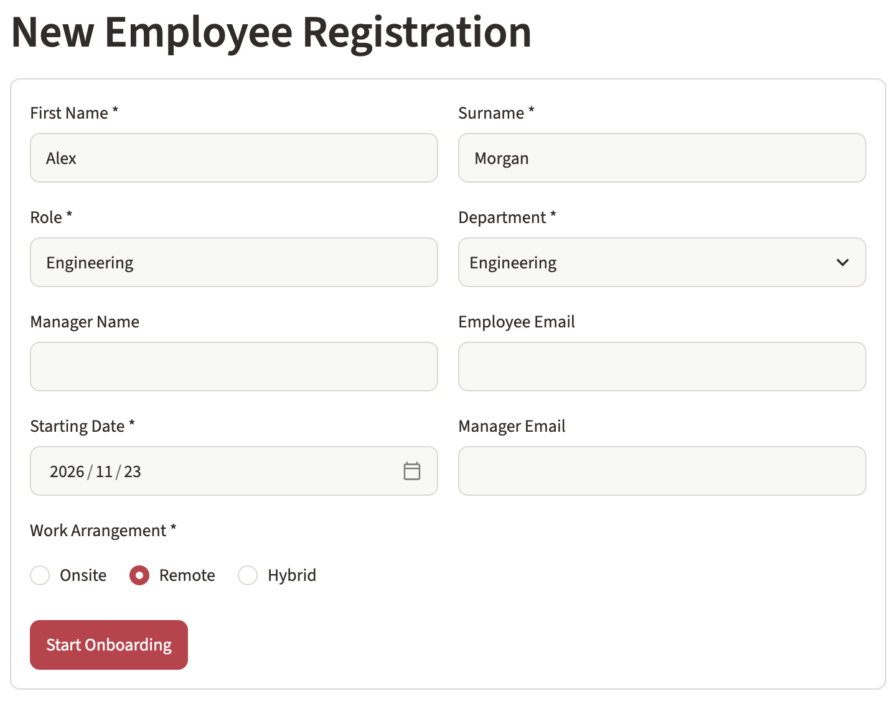
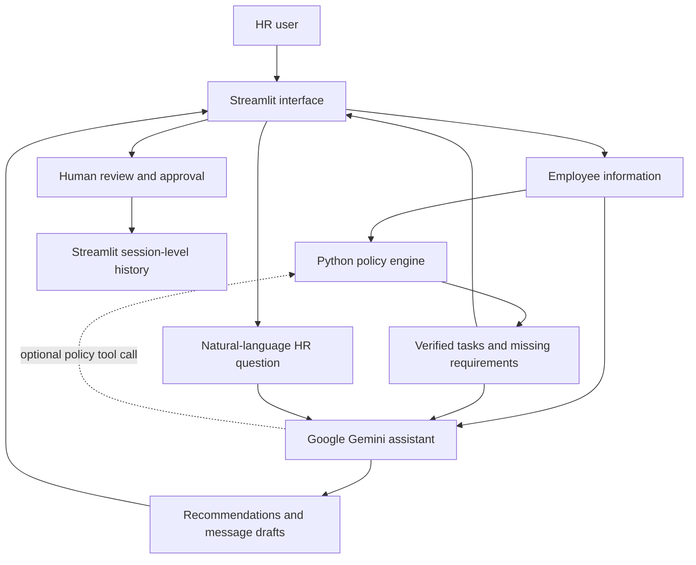

# AutoFirstHi 👋

**AI-assisted employee onboarding with deterministic policy checks, human approval, and LLM evaluation.**

[**Live demo**](https://autofirsthi.streamlit.app/) | [**Source code**](https://github.com/Somarel/autofirsthi)

AutoFirstHi is a Python and Streamlit prototype that helps HR teams prepare onboarding plans for new employees. It combines a rule-based workflow with a Google Gemini assistant that answers natural-language questions, recommends next steps, and drafts communications.

**This is a portfolio demonstration using a fictional company (DemoTech) and fictional employee records.** It does not send emails or create calendar events.

## Why combine Python and AI?

A language model is not needed to decide whether a required field is missing or whether a policy applies. Python handles those decisions deterministically. Gemini is used where language flexibility matters: interpreting HR questions, explaining onboarding context, identifying possible discrepancies, and drafting messages.

- **Python is authoritative** for selecting policies, generating task statuses (`Pending` or `Blocked`), and checking dependencies.
- **Gemini is an assistant**, generating natural-language recommendations and communication drafts from employee context and verified policy information.
- **A human remains in control** of communication approval. No external actions are executed by this prototype.

## Features

- Employee registration with department, work arrangement, manager information, and equipment preferences.
- Configurable DemoTech onboarding rules stored in `policies/general.json`.
- Policy selection and dependency-aware task generation.
- Welcome-email and manager-introduction meeting drafts, with approve/reject controls.
- Meeting-date checks for the first two working days (weekdays only).
- Session-level approval history.
- **Ask AutoFirstHi:** natural-language HR questions, context-aware suggestions, discrepancy notices, and draft messages using Gemini.
- A separate, Python-generated **Verified Onboarding Plan** that does not rely on the model's wording for task statuses.
- Automated Python tests and an experimental LLM evaluation workflow.

## Example scenario

A remote Engineering employee has selected a MacBook and iPhone, but their manager's name and email are missing.

The deterministic policy engine identifies `manager_introduction` as **Blocked**, while equipment preparation, Engineering IT preparation, remote orientation, and other applicable tasks remain **Pending**.

An HR user can then ask:

> What can we prepare now, and can you draft a message requesting the missing manager details?

Gemini can explain which preparations may proceed and draft a message for human review. It cannot change the verified task statuses or send the message.

## Screenshots

### Employee registration



### Policy-verified onboarding plan


## Architecture



The verified plan and the free-text AI response are distinct outputs. Python determines the task statuses; Gemini generates explanations and proposals. **The application does not yet automatically verify every claim made in the AI-generated text.** Response quality is assessed separately through the evaluation scripts.

## LLM Evaluation and Monitoring

AutoFirstHi includes a small experimental evaluation workflow:

1. Store fictional employee scenarios and expected behavior in `eval_cases.json`.
2. Generate and record Gemini responses, latency, API errors, and retry counts using `run_evaluation.py` and `run_batch_evaluation.py`.
3. Compare extractable task-status claims with Python ground truth and flag selected suspicious policy statements using `evaluate_response.py`.
4. Record human judgments of policy accuracy and helpfulness; summarize the recorded runs using `summarize_evaluations.py`.

### Initial experiment

Three repeated responses to **one fictional scenario** produced the following observations:

| Metric | Observed result |
|---|---:|
| Successful responses after application-level retries | 3/3 |
| First-attempt success | 2/3 |
| Average end-to-end response time | 12.21 seconds |
| Transient HTTP 503 errors encountered | 2 |
| Mean human-rated helpfulness | 4/5 |
| Responses with human-identified unsupported policy claims | 2/3 |

In one individually examined response, all seven explicitly reported task statuses agreed with Python ground truth (**7/7**). However, the model also described a welcome-email deadline as a company requirement even though the policy did not specify one.

**Key lesson:** A response can be useful and report correct task statuses while still introducing an unsupported policy claim. Simple text-pattern checks are screening tools, not comprehensive hallucination detection.

These results are preliminary and are **not** estimates of general model reliability.

## Technology Stack

- **Language:** Python
- **Interface:** Streamlit
- **AI:** Google Gemini API (`google-genai` SDK)
- **Business rules:** JSON policy configuration and Python functions
- **Testing:** pytest
- **Dependency management:** uv
- **Version control and deployment:** GitHub and Streamlit Community Cloud

## Run Locally

Clone the repository and install dependencies:

```bash
git clone https://github.com/Somarel/autofirsthi.git
cd autofirsthi
uv sync
```

Set your Gemini API key in your environment (never commit it to Git):

```bash
export GEMINI_API_KEY="your-api-key"
```

Start the app:

```bash
uv run streamlit run streamlit_app.py
```

Run the deterministic business-logic tests:

```bash
uv run pytest -q test_tools.py
```

Run a single AI evaluation (makes a real Gemini API request and may consume quota):

```bash
uv run python run_evaluation.py
uv run python evaluate_response.py
uv run python summarize_evaluations.py
```

The raw response log, `eval_results.json`, is excluded from version control.

Streamlit Community Cloud uses its own **Secrets** configuration for `GEMINI_API_KEY`.

## Project Files

| Path | Responsibility |
|---|---|
| `streamlit_app.py` | Employee form, draft review, approval history, and AI question interface |
| `agent.py` | Gemini integration, policy tools, and AI response generation |
| `tools.py` | Deterministic policy selection, task statuses, and draft preparation |
| `policies/general.json` | Fictional DemoTech onboarding rules |
| `test_tools.py` | 11 automated business-logic tests |
| `eval_cases.json` | Fictional evaluation scenarios and expected behaviors |
| `run_evaluation.py`, `run_batch_evaluation.py` | Response capture, retries, and request pacing |
| `evaluate_response.py`, `summarize_evaluations.py` | Experimental response checks and metrics |
| `review_evaluation.py`, `review_batch.py` | Manual review of saved responses |

## Limitations and Next Steps

- **Prototype, not a production HR system:** No user authentication, access controls, or persistent audit database.
- **Human-in-the-loop demonstration:** Approving a draft records a decision in the current Streamlit session; it does not send emails or schedule meetings.
- **Working-day calculation:** Excludes weekends but not public holidays.
- **LLM limitations:** Gemini may invent requirements, miss discrepancies, or suggest unperformed actions. The deterministic task list remains separate; AI-generated prose still requires review.
- **Evaluation scope:** The current experiment covers a small number of responses to one scenario; broader and versioned test cases are needed for reliable comparisons.
- **Privacy:** Use fictional employee information in the public demo. Do not put API keys or real HR records in the repository or evaluation logs.

---

**Portfolio focus:** Reliable workflow automation, practical generative AI integration, human oversight, and measurable LLM behavior.
